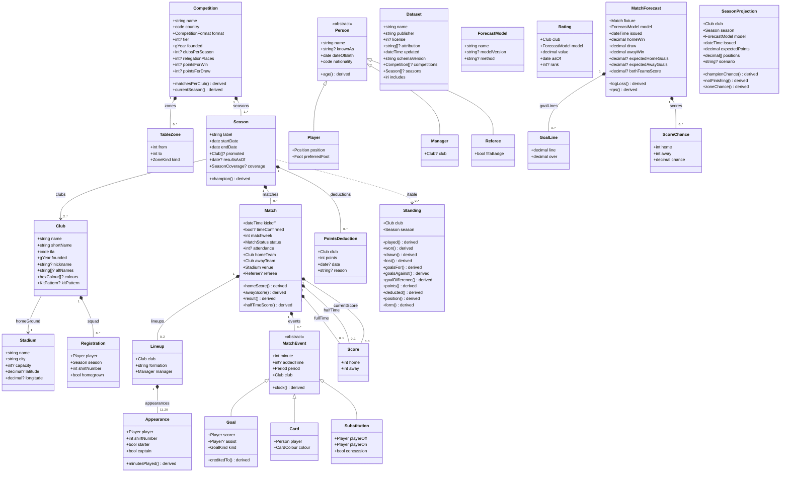

# Football Schema

A canonical, machine-readable model of association football in JSON-LD: competitions,
seasons, clubs, grounds, people, matches and league tables, with the Premier League as the
reference competition. Modelled on [Bitcoin Schema](https://bitcoin-desktop.github.io/schema/):
one schema, many projections.

**Record the events; derive everything else.** A match records what happened (or, when a source
gives only the score, a reported `fullTime`). The score, the result, minutes played and every
number in a league table are derived fields (`/name` in the diagram), defined in the schema and
implemented once in [`tools/model.js`](tools/model.js).

## Modules

| module | layer | contents |
|---|---|---|
| [`core`](schema/core.jsonld) | domain | Competition (with TableZones), Season (with PointsDeductions), Club, Registration, PlayerTotals, Stadium, Person → Player / Manager / Referee; Annotations allowed on any node (`sameAs`, `source`, `retrieved`) |
| [`match`](schema/match.jsonld) | event | Match, Score, Lineup, Appearance, MatchEvent → Goal / Card / Substitution; status, period, goal and card enums |
| [`table`](schema/table.jsonld) | projection | Standing: every column derived from finished matches |
| [`premier-league`](schema/premier-league.jsonld) | competition | Premier League rules: tie-break order, match, squad and season rules |
| [`catalogue`](schema/catalogue.jsonld) | catalogue | Dataset: who publishes the data, on what terms, and a link to every season and any other documents |
| [`forecast`](schema/forecast.jsonld) | forecast | ForecastModel, Rating, MatchForecast (with GoalLines and ScoreChances), SeasonProjection; ForecastRules. Scored once played (`/logLoss`, `/rps`) |

Another league reuses `core`, `match` and `table` and adds its own rules module.

## Data model

Generated from the schema by [`tools/gen-class-diagram.js`](tools/gen-class-diagram.js)
(also as [class-diagram.svg](class-diagram.svg)).



## Using it

Data in this vocabulary is JSON-LD with this repo's [`context.jsonld`](context.jsonld):

```json
{ "@context": "https://football-schema.github.io/schema/context.jsonld",
  "@graph": [ { "@id": "#this", "@type": "Club", "name": "Arsenal Football Club", "tla": "ARS", … } ] }
```

The package exports loaders, the derivations and a validator:

```js
import { loadSchema, loadDir, loadLinked, score, standing, classify } from 'football-schema/model.js';
import { validate } from 'football-schema/validate.js';

// from disk: every file under a directory
const problems = validate(await loadSchema(), await loadDir('data/'));   // [] when valid

// from the web: one address, every linked document (seasons -> matches -> clubs -> stadiums)
const g = await loadLinked('https://melvin.me/public/matchday/data/seasons/2026-27.jsonld');
const season = g.nodes.find((n) => n['@type'] === 'Season');
const matches = g.nodes.filter((n) => n['@type'] === 'Match');
const table = classify(season.clubs.map((c) => standing(c, matches, undefined, { deductions: season.deductions })));
```

`validate` checks every node against its class, that references resolve to the right types, and the
Premier League's match and season rules (for example a complete double round-robin).

`model.js` also runs in a browser as it is, with no install or build: import it from this site, and
`loadLinked` fetches the data (a path is relative to the page; data on another host needs CORS headers).
[matchday's viewer](https://melvin.me/public/matchday/view/) is built this way.

```html
<script type="module">
  import { loadLinked, standing, classify } from 'https://football-schema.github.io/schema/tools/model.js';
  const g = await loadLinked('https://melvin.me/public/matchday/data/seasons/2026-27.jsonld', { follow: ['clubs', 'matches'] });
</script>
```

Worked examples: [`2012-05-13-mci-qpr.jsonld`](examples/2012-05-13-mci-qpr.jsonld), Manchester City 3–2
QPR recorded as events only (`npm run derive` computes its score and table);
[`2023-24-deductions.jsonld`](examples/2023-24-deductions.jsonld), Everton's and Forest's points deductions
with their source and Wikidata identities; [`2012-05-13-forecast.jsonld`](examples/2012-05-13-forecast.jsonld),
an (illustrative) forecast for that MCI–QPR match in another document, scored by `forecastScore()`; and
[`dataset.jsonld`](examples/dataset.jsonld), a Dataset that links to them.

## Publishing data

So that anyone can build on what you publish:

- **Publish a [Dataset](schema/catalogue.jsonld)** at a stable address, conventionally `dataset.jsonld` at the
  data's root, linking every season. A consumer then needs that one address: `loadLinked` follows the links.
- **Keep addresses stable.** Consumers link to your IRIs; move a file and you break them. One document per
  season, per matchweek and per club works well (`seasons/2026-27.jsonld`, `matches/2026-27/mw08.jsonld`,
  `clubs/ARS.jsonld#this`).
- **Use relative IRIs between your files**, so the whole tree can be copied to another host unchanged.
- **Serve `application/ld+json` with `Access-Control-Allow-Origin: *`**, so pages on other sites can read it.
- **Say where it came from**: `source` and `retrieved` on any node, and the Dataset's `attribution` for
  credit lines your sources' terms require.
- **Publish forecasts before kick-off**, each pointing at the match in its own dataset (`fixture`), so anyone
  can score them once it is played. Say which model made them.
- **Give clubs `sameAs`** (their Wikidata entity) **and `altNames`**, so other datasets can be joined to
  yours without hand-made name tables.

Built on it: [matchday](https://melvin.me/public/matchday/), a Premier League scores site, and
[premelo](https://football-schema.github.io/premelo/), Elo ratings and predictions for twenty European leagues.

## Versioning

The schema and the package share one version (`schemaVersion` in a Dataset says which one data conforms
to). Until 1.0: a new version may add classes, fields and enumeration members, all optional, so data that was
valid stays valid; anything removed or renamed is first marked deprecated for at least one version, and the
change is listed below. IRIs (`urn:football:…`) never change meaning.

### Changes

- **Unreleased.** `model.js` runs in the browser as well as Node (the file system is used only in Node).
- **0.0.4.** Players from sources that list squads and season totals but not every goal: `PlayerTotals`
  (a player's league goals, matches, assists and penalties for one club in one season, as of a date).
  `Player.position`, `Player.preferredFoot`, `Registration.shirtNumber` and `Registration.homegrown` are
  optional, since few sources have them. `loadLinked` also follows `squad` and `player`.
- **0.0.3.** The `forecast` module: `ForecastModel`, `Rating`, `MatchForecast` (`GoalLine`, `ScoreChance`),
  `SeasonProjection` and `ForecastRules` (chances 0 to 1 that add up, issued before kick-off); `forecastScore()`,
  `zoneChance()` and `notFinishing()` (a projection's places may add up to less than 1, e.g. under an expulsion scenario). `Season.coverage` (`complete` or `partial`; a partial season is exempt from the round-robin
  rules). `Dataset.includes`, and `Dataset.seasons` may be empty. `loadLinked` fetches several documents at once.
- **0.0.2.** Annotations on any node: `sameAs`, `source`, `retrieved`. `Club.altNames`. `PointsDeduction`
  and `Season.deductions`, counted by `standing()` (and `Standing.deducted`). The `catalogue` module:
  `Dataset`. `loadGraph` reads over HTTP; `loadLinked` follows links from one address.
- **0.0.1.** First release: core, match, table and premier-league.

## Tools

```
npm run diagram   # regenerate class-diagram.svg + docs/class-diagram.mmd
npm run derive    # derived values for the examples
npm test          # schema closure, diagram freshness, examples, derivations
```

Zero dependencies; Node 20+. `index.html` is the schema reference, rendered from `schema/*.jsonld`.
Terms are named in the `urn:football:` namespace (so `Match` is `urn:football:Match`); the context and
this reference are published at <https://football-schema.github.io/schema/>.

