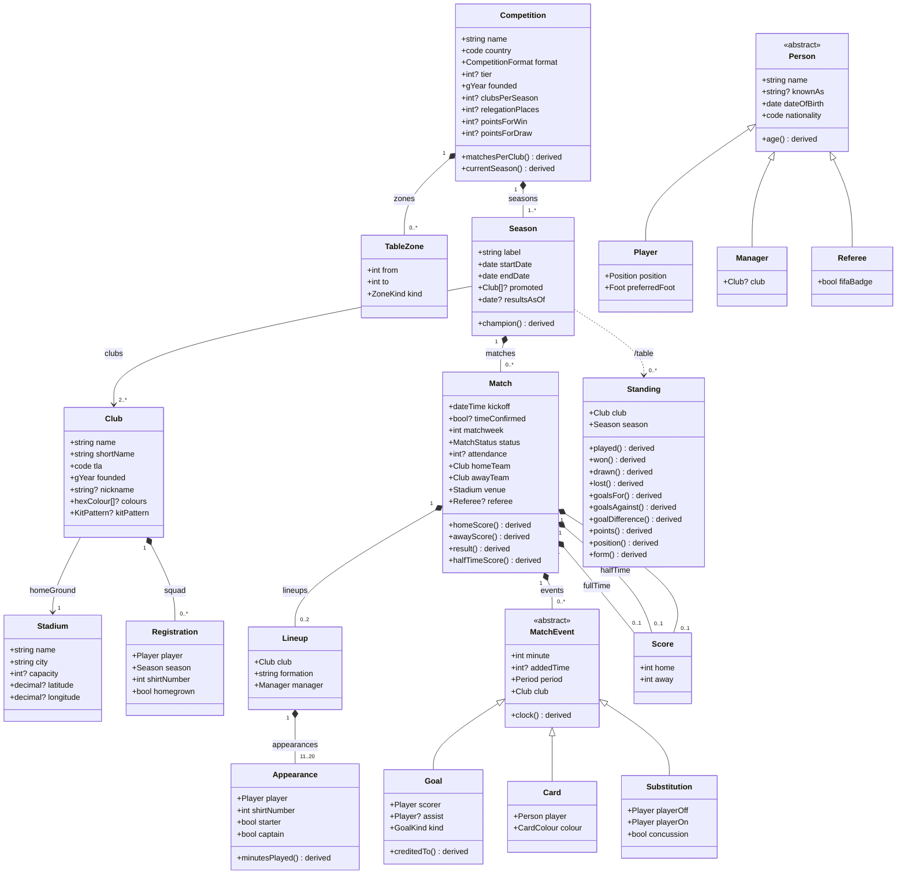

# Football Schema

A canonical, machine-readable model of association football in JSON-LD: competitions,
seasons, clubs, grounds, people, matches and league tables, with the Premier League as the
reference competition. Modelled on [Bitcoin Schema](https://bitcoin-desktop.github.io/schema/):
one schema, many projections.

**Record the events; derive everything else.** A match records what happened (or, when a source
gives only the score, a reported `fullTime`). The score, the result, minutes played and every
number in a league table are derived fields (`/name` in the diagram), defined in the schema and
implemented once in [`tools/model.js`](tools/model.js).

## Modules

| module | layer | contents |
|---|---|---|
| [`core`](schema/core.jsonld) | domain | Competition (with TableZones), Season, Club, Registration, Stadium, Person → Player / Manager / Referee |
| [`match`](schema/match.jsonld) | event | Match, Score, Lineup, Appearance, MatchEvent → Goal / Card / Substitution; status, period, goal and card enums |
| [`table`](schema/table.jsonld) | projection | Standing: every column derived from finished matches |
| [`premier-league`](schema/premier-league.jsonld) | competition | Premier League rules: tie-break order, match, squad and season rules |

Another league reuses `core`, `match` and `table` and adds its own rules module.

## Data model

Generated from the schema by [`tools/gen-class-diagram.js`](tools/gen-class-diagram.js)
(also as [class-diagram.svg](class-diagram.svg)).



## Using it

Data in this vocabulary is JSON-LD with this repo's [`context.jsonld`](context.jsonld):

```json
{ "@context": "https://football-schema.github.io/schema/context.jsonld",
  "@graph": [ { "@id": "#this", "@type": "Club", "name": "Arsenal Football Club", "tla": "ARS", … } ] }
```

The package exports a loader, the derivations and a validator:

```js
import { loadSchema, loadDir, score, standing, classify } from 'football-schema/model.js';
import { validate } from 'football-schema/validate.js';

const problems = validate(await loadSchema(), await loadDir('data/'));   // [] when valid
```

`validate` checks every node against its class, that references resolve to the right types, and the
Premier League's match and season rules (for example a complete double round-robin).

[`examples/2012-05-13-mci-qpr.jsonld`](examples/2012-05-13-mci-qpr.jsonld) is a worked example:
Manchester City 3–2 QPR, recorded as events only; `npm run derive` computes its score and table.

## Tools

```
npm run diagram   # regenerate class-diagram.svg + docs/class-diagram.mmd
npm run derive    # derived values for the examples
npm test          # schema closure, diagram freshness, examples, derivations
```

Zero dependencies; Node 20+. `index.html` is the schema reference, rendered from `schema/*.jsonld`.
Terms are named in the `urn:football:` namespace (so `Match` is `urn:football:Match`); the context and
this reference are published at <https://football-schema.github.io/schema/>.

Built on it: **matchday**, a Premier League scores site (a separate project).
